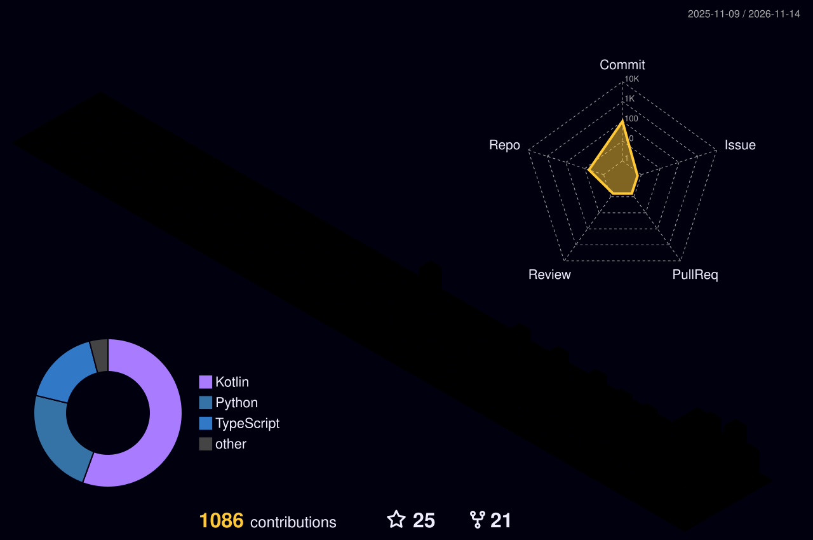

  

  
  
  
  

 

  

 

<h2 align="center">⚡ Tech Arsenal</h2>

  
   
  

 

<h2 align="center">📈 Activity</h2>

  

  

  <picture>
    <source media="(prefers-color-scheme: dark)" srcset="https://raw.githubusercontent.com/HakanYilmazzz/HakanYilmazzz/output/snake-dark.svg" />
    <source media="(prefers-color-scheme: light)" srcset="https://raw.githubusercontent.com/HakanYilmazzz/HakanYilmazzz/output/snake-light.svg" />
    
  </picture>

  

