  

  
  
  
  
  
  
  

 

  

 

<h2 align="center">⏱️ Coding Time</h2>

  

 

<h2 align="center">⚡ Tech Arsenal</h2>

  
   
  

 

  <picture>
    <source media="(prefers-color-scheme: dark)" srcset="https://raw.githubusercontent.com/HakanYilmazzz/HakanYilmazzz/output/snake-dark.svg" />
    <source media="(prefers-color-scheme: light)" srcset="https://raw.githubusercontent.com/HakanYilmazzz/HakanYilmazzz/output/snake-light.svg" />
    
  </picture>

 

<h2 align="center">🔥 Recent Activity</h2>

<!--START_SECTION:activity-->
1. 🚀 Published release [Masaüstü Mahallesi v1.0.3](https://github.com/HakanYilmazzz/MasaustuMahallesi/releases/tag/v1.0.3) in [HakanYilmazzz/MasaustuMahallesi](https://github.com/HakanYilmazzz/MasaustuMahallesi)
2. 🚀 Published release [Masaüstü Mahallesi v1.0.2](https://github.com/HakanYilmazzz/MasaustuMahallesi/releases/tag/v1.0.2) in [HakanYilmazzz/MasaustuMahallesi](https://github.com/HakanYilmazzz/MasaustuMahallesi)
3. 🚀 Published release [Masaüstü Mahallesi v1.0.1](https://github.com/HakanYilmazzz/MasaustuMahallesi/releases/tag/v1.0.1) in [HakanYilmazzz/MasaustuMahallesi](https://github.com/HakanYilmazzz/MasaustuMahallesi)
<!--END_SECTION:activity-->

 

<h2 align="center">📈 Activity</h2>

  

 

  

